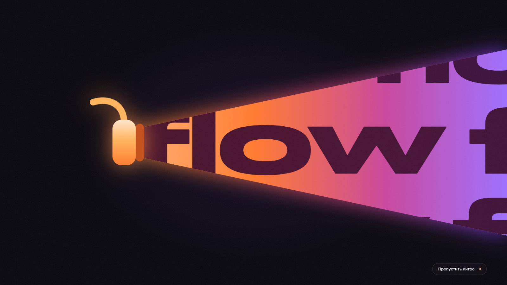
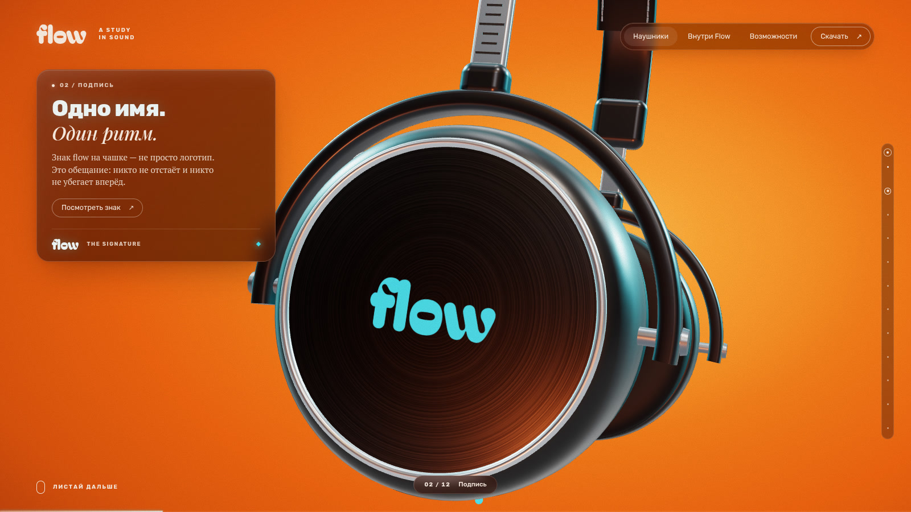
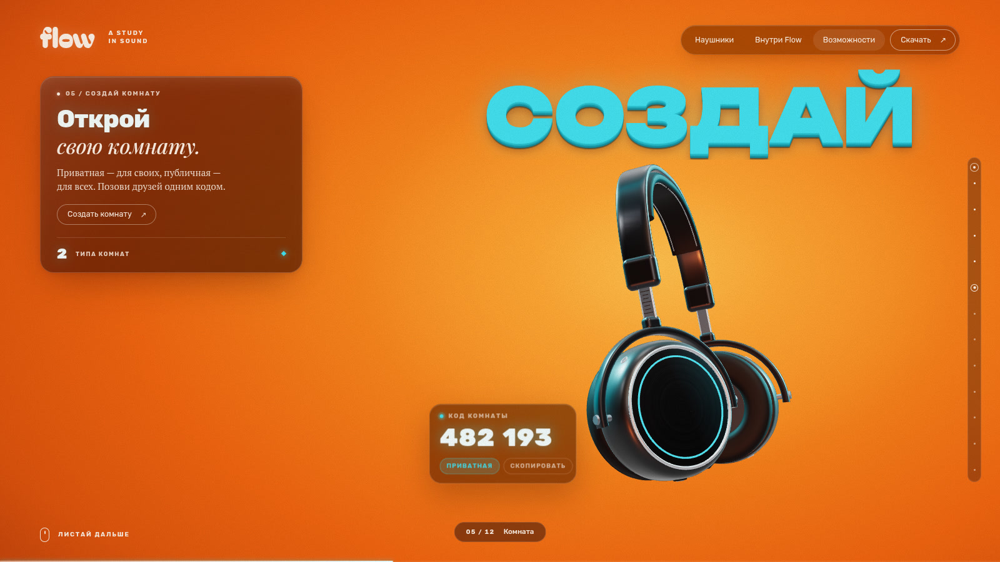
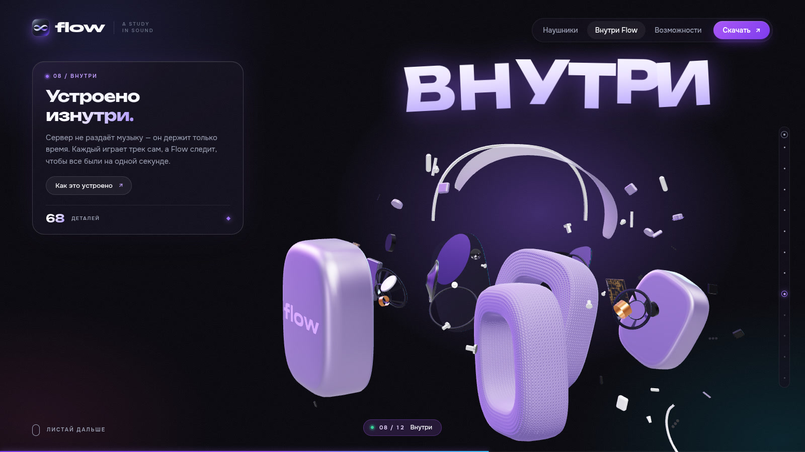
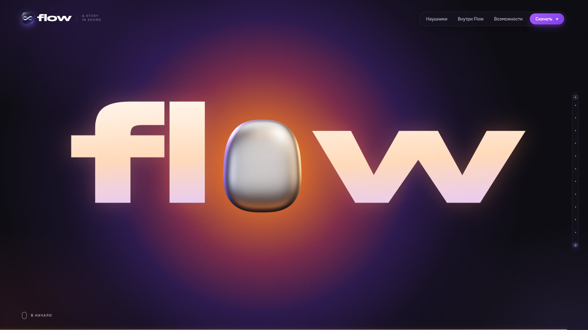

# Flow — лендинг

Скролл-лендинг для Flow, приложения для совместного прослушивания музыки: 3D-наушники собираются, разбираются и ведут через историю продукта.

**Живой сайт:** https://sempik.github.io/flow-landing/
**Само приложение:** https://flowww.space



| | |
|---|---|
|  |  |
| Глава 2, «Подпись»: крупный план чашки с логотипом | Глава 5, «Создай комнату»: код комнаты |
|  |  |
| Глава 8, «Внутри»: разлёт деталей | Финал: чашка становится буквой «o» в логотипе |

<p align="center"><br><sub>Та же глава на телефоне</sub></p>

## Что внутри

- **Three.js r160** — процедурная модель наушников из 67 деталей, без загружаемых 3D-файлов. В главе «Внутри» модель разлетается на детали и собирается обратно.
- **GSAP ScrollTrigger + Lenis** — плавный скролл и привязка всей анимации к прогрессу страницы.
- **14 глав**: интро, 12 смысловых глав и финал. Между ключевыми позами глав сцена плавно интерполирует камеру, положение модели и степень разлёта.
- **Один html-файл** без сборщиков и npm: шаблон, стили и скрипты склеиваются PowerShell-скриптом, библиотеки и шрифты грузятся с CDN.
- **Адаптив**: десктоп, телефон в портретной и альбомной ориентации.
- **prefers-reduced-motion**: без инерционного скролла и автопрокрутки, переходы по меню и рейке мгновенные, лишнее движение сцены выключено.
- **Фолбэк без 3D**: если 3D-модуль не загрузился, страница показывает статичную раскладку с текстами и рабочей навигацией.

## Как собрать

Нужен только PowerShell (Windows PowerShell 5.1 или PowerShell 7).

```powershell
.\build.ps1
```

Скрипт склеивает `index.src.html`, `styles.css`, `headphones.js` и `app.js` в `dist\index.html`. Получившийся файл самодостаточен: его можно открыть двойным кликом.

При пуше в `main` GitHub Actions (`.github/workflows/pages.yml`) собирает сайт тем же скриптом и публикует его на GitHub Pages.

## Проверка

`shoot.ps1` (скриншоты в нужных точках скролла) и `test.ps1` (функциональный автотест: скролл, клики, ресайз, мобилка, шрифты, ошибки консоли) гоняют headless Chrome не локально, а на удалённом Linux-сервере, чтобы не грузить рабочую машину.

1. Скопируй `remote.example.ps1` в `remote.local.ps1` и впиши свой сервер, ssh-ключ и рабочую папку. `remote.local.ps1` в `.gitignore`.
2. На сервере должны стоять google-chrome, ffmpeg и node. Один раз запусти там `_dev/setup-remote.sh <рабочая папка>`: он ставит puppeteer-core для автотеста.
3. Запуск:

```powershell
.\build.ps1
.\shoot.ps1 -Query "ch=1","ch=8" -W 1600 -H 900   # -> _shots\*.jpg
.\test.ps1                                         # -> _test\report.txt
```

Параметр `?ch=N` ставит страницу ровно в центр главы N, `?p=0.03` — в точку по общему прогрессу.

## Структура

```
index.src.html      шаблон страницы: разметка карточек, меню, рейки, importmap
styles.css          все стили
headphones.js       3D-сцена: процедурные наушники, ключевые позы глав, разлёт
app.js              скролл, интро, переключение глав, интерфейс
build.ps1           склейка в dist\index.html
shoot.ps1           скриншоты на удалённом сервере
test.ps1            автотест на удалённом сервере
remote.example.ps1  шаблон настроек сервера
SPEC.md             подробное ТЗ: главы, раскладка, контракт сцены
_dev/               заглушки, прототипы сцены и интерфейса, серверные скрипты
media/              скриншоты для README
```

## Благодарности

Вдохновлено концепт-сайтом Canon EOS 60D от студии weblove.

## Лицензия

[MIT](LICENSE)
